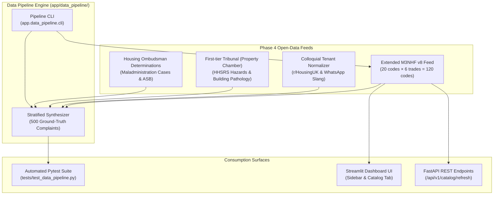

# Phase 4 Feeds & Open-Data Pipeline Guide

This guide details the **Phase 4 Open-Data Feeds and Test Data Pipeline** in the Social Housing Complaint Classifier Sandbox. It explains what each feed does, how the underlying data is structured, and how to use these feeds across the **Streamlit Dashboard UI**, **FastAPI REST API**, **CLI**, and **Python SDK**.

---

## 1. Executive Summary & Architecture

In responsive repairs triage, evaluating complaints using only a tiny sample catalog often results in complaints falling back to `"OTHER"` (`OUT_OF_SCHEDULE_SCOPE` / `SURVEYOR_DESK_REVIEW`). 

Phase 4 introduces an **Open-Data Ingestion & Synthesis Pipeline** rooted in statutory UK social housing benchmarks (Housing Ombudsman Service determinations and First-tier Tribunal Property Chamber decisions) and expands the active M3NHF Schedule of Rates (SOR) catalog up to **20 authentic codes per trade** (120 total codes).



---

## 2. Feed Inventory & Capabilities

### Feed 1: Extended M3NHF Schedule of Rates Feed (120 Codes)
* **Location:** `app/data_pipeline/taxonomy.py` (`ADDITIONAL_M3NHF_SOR_BY_TRADE`, `build_extended_m3nhf_sor_feed`)
* **Scope:** 20 authentic M3NHF v8 codes for each of the 6 repair trades:
  - **Section 19 (PLUM - Plumbing & Heating):** TRV radiator valves, ball valves, waste traps, copper supply leaks, unvented cylinders, stopcocks, bath wastes, soil stacks, pillar taps, mixer taps, shower cartridges.
  - **Section 11 (DAMP - Damp & Mould):** Awaab's Law fungicidal washes, chemical DPC injection, humidistat extract fans, brickwork repointing, cavity wall tie inspection, subfloor airbrick clearance, anti-condensation thermal paint.
  - **Section 10 (ROOF - Roofing & Rainwater):** Concrete interlocking tiles, eaves gutter clearance, lead flashing dressing, valley gutters, chimney pot cowls, roof verge mortar, rainwater downpipes.
  - **Section 12 (JOIN - Carpentry & Joinery):** uPVC window espagnolette mechanisms, FD30 fire door easing & intumescent strips, multi-point entrance door locks, sash window cords, kitchen base carcasses, worktops, floorboards.
  - **Section 21 (ELEC - Electrical & Extraction):** Water ingress in light fittings, 13A switched sockets, optical smoke alarms, consumer units, bathroom extract fans, immersion heater switches.
  - **Section 16 (PLAS - Plastering & Finishes):** Blown wall plaster skimming, water-damaged ceiling overboarding, ceramic wall tiling splashbacks, external bellcast render beads.

### Feed 2: Housing Ombudsman Determination Feed
* **Location:** `app/data_pipeline/ombudsman_harvester.py`
* **Scope:** Real-world case determinations categorized by finding (*Severe Maladministration*, *Maladministration*, *Service Failure*).
* **Usage:** Provides realistic case seeds with multi-vulnerability tenant profiles (infant asthma, elderly residents, disabled mobility) and non-repair workflows (ASB, Complaint Handling Code escalation breaches).

### Feed 3: First-tier Tribunal (Property Chamber) Defect Feed
* **Location:** `app/data_pipeline/tribunal_harvester.py`
* **Scope:** HHSRS (Housing Health and Safety Rating System) Category 1 & 2 hazards linked to technical surveyor specs and paired with colloquial tenant language.

### Feed 4: Colloquial Tenant Normalizer
* **Location:** `app/data_pipeline/reddit_normalizer.py`
* **Scope:** Generates authentic tenant phrasing without leaking the numeric SOR code, incorporating common UK colloquialisms (`rad`, `loo`, `airbrick`, `blown plaster`, `trip switch box`).

### Feed 5: Stratified Ground-Truth Synthesizer
* **Location:** `app/data_pipeline/synthesizer.py`
* **Distribution Proportions:**
  - **60% Repairs** (PLUM 25%, DAMP 20%, JOIN 17%, ELEC 14%, ROOF 14%, PLAS 10%)
  - **18% Anti-Social Behaviour (ASB)**
  - **14% Complaint Escalations (Stage 1 / Stage 2)**
  - **8% Rent & Service Charge Inquiries**

---

## 3. How to Use the Feeds

### Method A: Streamlit Dashboard UI (No Code)

The dashboard allows you to import SOR codes from the Phase 4 feed directly in your browser:

#### 1. Via Sidebar Section 4 ("📚 4. Refresh SOR Codes")
1. Open the **Live Sandbox Dashboard** (`/sandbox`).
2. Look at **Section 4 of the Sidebar Control Deck**. Notice the schedule status badge:
   - `⚪ Base Schedule (18 core codes)`
3. Under **Select Trade Type to Refresh**, choose a specific trade (e.g., `🪚 JOIN — Carpentry & Joinery (3/20 active)`) or `🌐 ALL — Import Up to 20 Codes Across All 6 Trades`.
4. Adjust the **Max SOR Codes for Trade** slider (between 5 and 20, default: `20`).
5. Click **"📥 Refresh SOR Catalog from Feed"**.
6. The schedule status updates to `🟢 Expanded Schedule (X active codes)`.

#### 2. Via the M3NHF Catalog Tab (`tab_catalog`)
1. On the main stage of the dashboard, select the **`📚 M3NHF Schedule of Rates Catalog`** tab.
2. In the top container bar:
   - Select the trade from the dropdown.
   - Adjust the slider.
   - Click **"📥 Import up to N Codes"**.
3. The catalog table instantly reflects the newly imported M3NHF codes.

#### 3. Resetting to the Base Set
Both reset buttons restore the schedule to the clean 18-code baseline:
- Click **"🔄 Reset My Workspace to Baseline"** in the sidebar.
- Or click **"↩️ Reset to Base (18)"** directly in the Catalog tab.

---

### Method B: Command-Line Interface (CLI)

Use `app/data_pipeline/cli.py` to generate benchmark datasets or refresh catalogs:

#### 1. Generate 500 Stratified Ground-Truth Complaints
```bash
.venv/bin/python -m app.data_pipeline.cli \
  --samples 500 \
  --output data/synthetic_complaints_500.jsonl \
  --seed 42
```
*Output:* Creates `data/synthetic_complaints_500.jsonl` with 300 repairs, 90 ASB, 70 escalations, and 40 rent queries.

#### 2. Refresh a Trade's SOR Schedule via CLI
```bash
# Refresh Plumbing to 20 codes
.venv/bin/python -m app.data_pipeline.cli --refresh-trade PLUM --max-codes 20

# Refresh All 6 trades (120 codes)
.venv/bin/python -m app.data_pipeline.cli --refresh-trade ALL --max-codes 20

# Reset back to the 18-code Base Set
.venv/bin/python -m app.data_pipeline.cli --reset-catalog
```

---

### Method C: FastAPI REST API

The backend exposes dedicated endpoints for automation and testing:

#### 1. Import Codes for a Trade (`POST /api/v1/catalog/refresh`)
```bash
curl -X POST http://127.0.0.1:8000/api/v1/catalog/refresh \
  -H "Content-Type: application/json" \
  -d '{"trade": "JOIN", "max_codes": 20, "session_id": "default"}'
```

*Response:*
```json
{
  "status": "sor_catalog_refreshed",
  "refreshed_trades": ["JOIN"],
  "max_codes_per_trade": 20,
  "imported_count": 20,
  "total_active_codes": 35,
  "total_base_codes": 18,
  "is_expanded": true,
  "counts_by_trade": {
    "PLUM": 4,
    "DAMP": 4,
    "ROOF": 2,
    "JOIN": 20,
    "ELEC": 3,
    "PLAS": 2
  }
}
```

#### 2. Reset Catalog to Base Set (`POST /api/v1/catalog/reset`)
```bash
curl -X POST http://127.0.0.1:8000/api/v1/catalog/reset
```

#### 3. Inspect Active Catalog & Summary (`GET /api/v1/catalog`)
```bash
curl http://127.0.0.1:8000/api/v1/catalog
```

---

### Method D: Python API

You can call the feed loaders directly in scripts or test fixtures:

```python
from app.data_pipeline.taxonomy import (
    build_extended_m3nhf_sor_feed,
    get_feed_sors_for_trade,
)
from app.domain.sor_catalog import (
    refresh_sor_catalog_for_trade,
    reset_sor_catalog_to_base,
    get_catalog_summary,
)

# 1. Inspect feed items
join_items = get_feed_sors_for_trade("JOIN", max_codes=20)
print(f"Loaded {len(join_items)} joinery codes from feed.")

# 2. Mutate active schedule in-place
summary = refresh_sor_catalog_for_trade("JOIN", max_codes=20)
print("Active schedule expanded:", summary["is_expanded"])

# 3. Reset back to base
reset_summary = reset_sor_catalog_to_base()
print("Reset complete, total codes:", reset_summary["total_active_codes"])
```

---

## 4. End-to-End Walkthrough: Eliminating "OTHER" Fallbacks

Here is a concrete test scenario demonstrating why and how to use the feed:

| Step | State | Action | Complaint Text | Result |
| :--- | :--- | :--- | :--- | :--- |
| **1** | **Base Set (18 codes)** | Submit Custom Complaint | *"The espagnolette lock mechanism inside the bedroom uPVC casement window handle is jammed and broken so the window won't latch shut."* | **Assigned Trade:** `JOIN`<br/>**Assigned SOR:** `OTHER`<br/>**Destination:** `SURVEYOR_DESK_REVIEW` |
| **2** | **Refresh Feed** | Click **"📥 Refresh SOR Catalog"** for trade `JOIN` (20 codes) | — | Catalog expands from 18 to 35 codes (20 in `JOIN`). |
| **3** | **Re-evaluate Complaint** | Submit the exact same complaint | *"The espagnolette lock mechanism inside the bedroom uPVC casement window handle is jammed and broken so the window won't latch shut."* | **Assigned Trade:** `JOIN`<br/>**Assigned SOR:** `122004` (Score 0.86)<br/>**Destination:** `AUTO_DISPATCH_HMS` ✅ |
| **4** | **Reset** | Click **"🔄 Reset to Baseline"** | — | Catalog returns to 18 codes. |

---

## 5. Summary Reference Table

| Target | Feed / Module | UI Control | CLI / API Command |
| :--- | :--- | :--- | :--- |
| **Import Trade Codes** | `taxonomy.py` | Sidebar Section 4 & Catalog Tab | `POST /api/v1/catalog/refresh` or `--refresh-trade <TRADE>` |
| **Reset Schedule** | `sor_catalog.py` | Sidebar "Reset to Baseline" & Tab "Reset to Base" | `POST /api/v1/catalog/reset` or `--reset-catalog` |
| **Synthesize 500 Cases** | `synthesizer.py` | — | `python -m app.data_pipeline.cli --samples 500` |
| **Inspect Case Seeds** | `ombudsman_harvester.py` | — | `harvest_ombudsman_determinations(limit=20)` |
| **Inspect HHSRS Hazards** | `tribunal_harvester.py` | — | `harvest_tribunal_seeds(trade_filter="DAMP")` |
